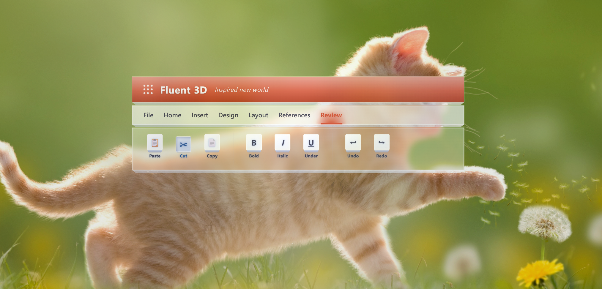
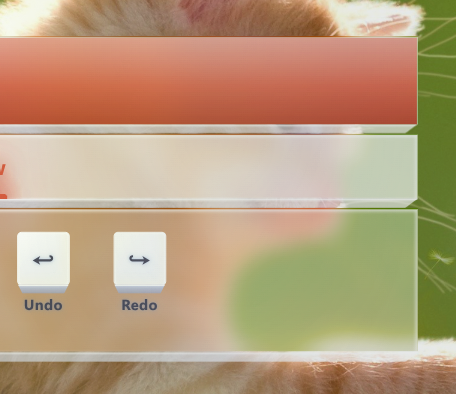
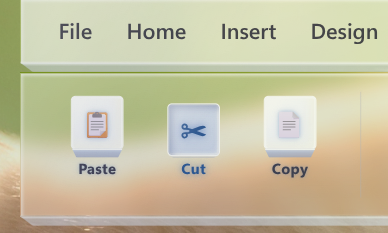
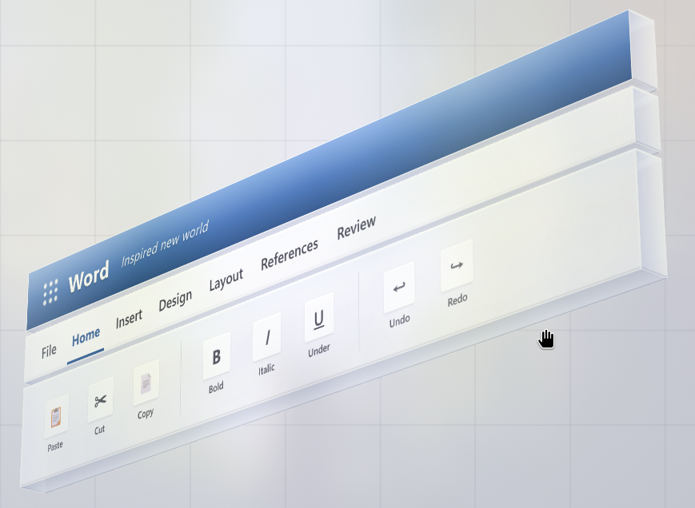
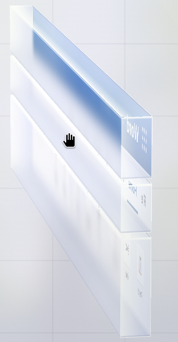

# Fluent 3D UI

> Inspired by Microsoft [Fluent Design](https://www.microsoft.com/design/fluent/), a pure-CSS 3D layered-glass interface that re-imagines the classic Office ribbon as a stack of light-refracting **glass boards**.

A zero-dependency, single-file UI experiment that turns a familiar productivity-software chrome (brand bar → menu bar → ribbon) into a tactile stack of fluted glass panels — complete with thickness, refraction, frosted inner glow, light beams and pressable 3D buttons.



## ✨ Highlights

- **Layered glass boards** — each panel is a real glass slab with a trapezoid thickness face, specular edge highlights and inner scatter glow.
- **Light & atmosphere** — adjustable directional light beam, frosted background, scatter glow and dual image layers (under / above the glass).
- **Pressable 3D buttons** — ribbon tools physically depress with a thickness face on hover / click.
- **Menu indicator** — a spring-animated, glowing underline that slides between menu items.
- **Real-time studio** — every parameter (color, blur, thickness, glow, spacing, height, presets) is tweakable live from a glass control panel.
- **Two builds, one idea**:
  - `Fluent3D.html` — the full **studio**: reusable engine + real-time tuning panel.
  - `Fluent3DView.html` — the pure **viewer**: true 6-face 3D boards in perspective with drag-to-rotate + inertia.

## 🖼 Preview

### Studio — glass over a photo background

| Glass over image | Pressable ribbon buttons |
| --- | --- |
|  |  |

### Viewer — true 3D, drag to rotate

| Perspective | Edge-on (real thickness) |
| --- | --- |
|  |  |

## 🚀 Quick Start

No build step, no dependencies. Just open a file in any modern browser:

```bash
# serve locally (optional, for best backdrop-filter behavior)
python3 -m http.server 8000
# then open http://localhost:8000
```

- **`Fluent3D.html`** — open the tuning studio. Click section headers to expand/collapse; use the top-right panel to edit every property live.
- **`Fluent3DView.html`** — open the 3D viewer. **Drag** to rotate the glass stack; it carries momentum with inertia.

## 🧱 File Structure

```
.
├── Fluent3D.html          # Studio — parameter tuning engine + glass control panel
├── Fluent3DView.html      # Viewer — true 3D perspective, drag-to-rotate
├── docs/images/           # Preview screenshots
├── LICENSE
└── README.md
```

## 🎛 Parameter System

Everything is driven by CSS custom properties defined on `:root`, so the whole design can be re-skinned by just overriding a handful of variables — or live via the studio panel.

Key variable groups:

| Group | Variables |
| --- | --- |
| Glass slab | `--glass-tint` `--glass-edge` `--glass-blur` `--glass-saturate` `--glass-brightness` |
| Thickness face | `--thickness-color` `--thickness-shade` `--thickness-h` `--thickness-narrow` `--board-gap` |
| Frosted background | `--bg-frost-tint` `--bg-frost-blur` |
| Image layers | `--bg-img-opacity` `--bg-img-blur` `--fg-img-opacity` `--fg-img-blur` |
| Light | `--beam-color` `--beam-strength` `--beam-angle` `--beam-x` `--glow-color` `--glow-strength` |
| Brand / accent | `--s1-brand` `--brand-color` `--brand-glow` |
| Icon buttons | `--btn-height` `--btn-size` `--btn-glow` |

## 🛠 Configuration Export

In `Fluent3D.html`, call `window.exportConfig()` from the DevTools console to dump the current full configuration as a JSON object — handy for persisting a theme.

## 🧰 Browser Support

Targets modern evergreen browsers that support `backdrop-filter` and `color-mix`:

- Chrome / Edge 111+
- Firefox 132+ (backdrop-filter enabled)
- Safari 16.2+

A graceful gradient fallback is provided for `color-mix`.

## 📄 License

Released under the [MIT License](LICENSE). Free to use, modify, and distribute.

---

Built with ❤️ and pure CSS.